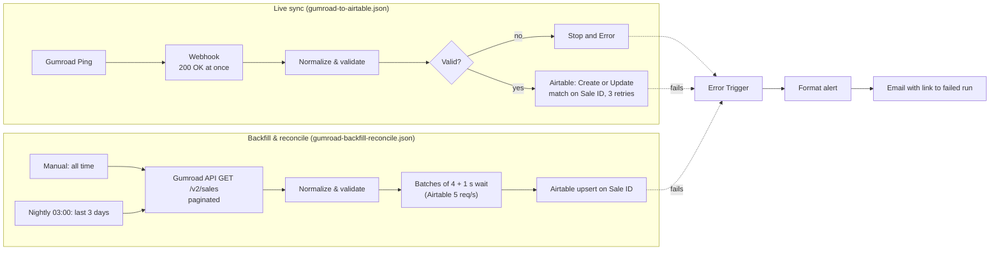

# Gumroad → Airtable (n8n)

Every Gumroad sale lands in an Airtable table within seconds: buyer email, date, amount, product ID and more. Refunds update the same row. A sale can't appear twice, and if anything fails you get an email.

**Problem.** You sell on Gumroad and want every buyer in Airtable for follow-ups. Naive "webhook → create record" setups break quietly: Gumroad re-sends the same ping, refunds reuse the sale ID, and a missed ping means a missing customer that nobody notices.

**Solution.** Two importable n8n workflows: a live sync that upserts on `Sale ID`, and a backfill/reconcile job that imports history and fills gaps every night. Every failure sends an email with a link to the failed run.

| File | What it does |
|---|---|
| `workflow/gumroad-to-airtable.json` | **Live.** Gumroad Ping (sale webhook) → normalize & validate → Airtable *Create or Update* on `Sale ID`. Invalid payloads and Airtable errors trigger an email alert. |
| `workflow/gumroad-backfill-reconcile.json` | **History + safety net.** A manual run imports all past sales from the Gumroad API. A nightly run re-checks the last 3 days and catches any ping Gumroad dropped. Duplicates are impossible because it uses the same upsert. |



## Why it is built this way

These choices come from Gumroad's own Ping documentation:

- **Ping is delivered "at least once"**, so the same sale can arrive 2–4 times. The Airtable step is *Create or Update* merged on `Sale ID`, so repeats update the same row and never add one. There's no separate "already seen" cache: a cache can mark a ping as done before Airtable confirms the write, and then the sale is lost silently.
- **A refund has the same `sale_id` as the sale, and it can arrive first.** Refunds flip `Refunded` on the same row. `Refunded` is only ever written as *true*, so a late or retried sale ping can't un-refund a row.
- **Gumroad waits only 5 seconds and stops after 4 retries.** The webhook answers right away and works afterwards. The nightly reconcile reads `GET /v2/sales` and fills any gaps.
- **Form-encoded payload, everything is a string.** The Code node turns `"2900"` into `29.00`, `"true"` into a checkbox, `variants[Tier]=Pro` into `Tier: Pro`, and the timestamp into ISO date-time. It also lowercases the email.

## Import in 2 minutes

1. n8n → **Workflows → Import from File** → `workflow/gumroad-to-airtable.json`. Repeat for `gumroad-backfill-reconcile.json` if you want history and the nightly safety net.
2. Create the credentials. Each node asks for one; just pick or create it:
   - **Airtable Personal Access Token**: airtable.com/create/tokens, scopes `data.records:read`, `data.records:write`, `schema.bases:read`, access to your base.
   - **SMTP** for alerts (Gmail app password, Brevo, Mailgun… any SMTP). You can swap the Email node for Slack or Telegram in one click.
   - **Gumroad API** (backfill only): Gumroad → Settings → Advanced → Applications → create app → *Generate access token*.
3. Open the **Airtable: upsert by Sale ID** node → pick your **base** and the table **Sales**.
4. Open **Email alert** → set your address.
5. **Publish/Activate** the live workflow. Activate the backfill workflow too: the nightly schedule and its own error alerts only run when it's active. To import history, open it and click **Execute workflow** once.

No keys are stored in the JSON. Credentials are referenced by name and filled inside n8n.

## Airtable base: table `Sales`

Create a table named **Sales** with these fields. The names must match exactly. Field types are a recommendation, and `typecast` is on, so Airtable converts values.

| Field | Airtable type | From Gumroad |
|---|---|---|
| Sale ID | Single line text (**primary field**) | `sale_id` (API: `id`). Upsert key |
| Order Number | Number | `order_number` |
| Sale Date | Date, include time (GMT) | `sale_timestamp` |
| Email | Email | `email` (trimmed, lowercase) |
| Full Name | Single line text | `full_name` |
| Product Name | Single line text | `product_name` |
| Product ID | Single line text | `product_id` |
| Product Permalink | Single line text | `product_permalink` |
| Amount | Currency or Number (2 decimals) | `price` ÷ 100 (Ping is always USD cents) |
| Currency | Single line text | `USD` for Ping, sale currency for API |
| Quantity | Number | `quantity` |
| Variants | Long text | `variants[...]` → `Tier: Pro, Size: L` |
| Offer Code | Single line text | `offer_code` |
| Country | Single line text | `ip_country` |
| Can Contact | Checkbox | `can_contact` (did the buyer allow follow-up emails) |
| Subscription ID | Single line text | `subscription_id` |
| Refunded | Checkbox | `refunded` or `resource_name = refund` |
| Disputed | Checkbox | `disputed` |
| Test | Checkbox | `test` (your own purchase or a "Send test ping") |
| Source | Single select | `Gumroad Ping` / `Gumroad API` |
| Last Event | Single line text | `sale`, `refund`, `api-sync` |
| Synced At | Date, include time | when n8n wrote the row |

Card details and license keys are deliberately **not** stored.

## Connect Gumroad

1. In n8n, open the **Gumroad Ping (sale webhook)** node and copy the **Production URL**. It looks like `https://YOUR-N8N/webhook/gumroad-sale`.
2. Gumroad → **Settings → Advanced → Ping** → paste the URL → **Update settings**.
3. Click **Send test ping**. Gumroad posts your latest sale with `test=true`, and a row appears in **Sales** with *Test* ticked.
4. Optional, recommended: turn on **ping signing** in the same settings page.

To ignore test pings entirely, set `SKIP_TEST_SALES = true` at the top of the **Normalize & validate** node.

## Test without Gumroad (fake data)

This POST is the same form-encoded format Gumroad sends. Replace the URL with your **Test URL** (after clicking *Listen for test event*) or your Production URL:

```bash
curl -X POST "https://YOUR-N8N/webhook/gumroad-sale" \
  -H "Content-Type: application/x-www-form-urlencoded" \
  --data-urlencode "sale_id=FAKEsale_Q1w2E3r4T5==" \
  --data-urlencode "sale_timestamp=2026-11-26T09:41:12Z" \
  --data-urlencode "order_number=524459995" \
  --data-urlencode "seller_id=FAKEseller_AbC123==" \
  --data-urlencode "product_id=FAKEprod_Xyz789==" \
  --data-urlencode "product_name=Notion Creator Kit" \
  --data-urlencode "product_permalink=https://demo-store.gumroad.com/l/creatorkit" \
  --data-urlencode "email=Jane.Buyer@Example.com" \
  --data-urlencode "full_name=Jane Buyer" \
  --data-urlencode "price=2900" \
  --data-urlencode "currency=usd" \
  --data-urlencode "quantity=1" \
  --data-urlencode "variants[Tier]=Pro" \
  --data-urlencode "offer_code=LAUNCH20" \
  --data-urlencode "ip_country=United States" \
  --data-urlencode "can_contact=true" \
  --data-urlencode "refunded=false" \
  --data-urlencode "resource_name=sale" \
  --data-urlencode "test=true"
```

Expected: one row, `Sale ID = FAKEsale_Q1w2E3r4T5==`, `Email = jane.buyer@example.com`, `Amount = 29`. Run the same command again and there's still **one** row. Send it once more with `resource_name=refund` and `refunded=true`: the same row gets *Refunded* ticked.

`samples/sample_sale.json` has the full fake payload with every field.

## Offline logic test (no n8n, no Airtable)

```bash
python3 test_logic.py      # needs Node.js 18+ and Python 3.9+
```

It runs the **exact** JavaScript from the n8n Code node (checked byte-for-byte against both workflow files) against an Airtable emulator. The emulator does PATCH upserts on `Sale ID` and returns a 422 on unknown columns. The test replays retries, a refund before its sale, invalid payloads, a backfill overlapping live pings, a JPY sale, and an Airtable outage followed by a reconcile.

## Verified on a real n8n (2.49.6, local, fake credentials)

`tools/run_local_n8n.sh` + `tools/fake_smtp.py` + `tools/e2e_local.py`:

- Both files import with the CLI (`import:workflow`). The live workflow publishes, and every node type and version resolves.
- A form-encoded POST of the sample gets **200 in 0.02 s**. Normalize produces the exact row shown above, *Valid?* → Airtable node. The fake token correctly fails at Airtable, and the **Error Trigger sends the alert email**, which is captured locally.
- An invalid payload (`email=not-an-email`) goes to *Reject invalid payload*, and an alert email follows with the reason and a link to the failed run.
- Backfill with fake API pages (manual run against a mocked Gumroad API: 2 pages, 10 sales, 1 duplicate): **9 unique** sales go to Airtable in batches of 4/4/1 with a 1 s pause, under Airtable's 5 req/s limit.

To reproduce: `cd .n8n-runtime && npm i n8n`, then `tools/run_local_n8n.sh`, `python3 tools/fake_smtp.py` (Python 3.9–3.11, it uses `smtpd`) and `python3 tools/e2e_local.py`. `tools/e2e_creds.json` holds **fake** credentials only (fake tokens, SMTP on 127.0.0.1).

## Prefer Make.com? Same logic, same columns

```
1. Webhooks › Custom webhook            ← paste its URL into Gumroad › Settings › Advanced › Ping
                                         (Make answers 200 right away and queues the run)
2. Tools › Set multiple variables       amount = price / 100, email = lower(trim(email)),
                                         refunded = (refunded = "true" OR resource_name = "refund")
3. Filter "valid"                        sale_id, email, product_id exist
4. Airtable › Search records            table Sales, formula: {Sale ID} = "{{sale_id}}", limit 1
5. Router
   ├─ found     → Airtable › Update a record (record ID from step 4); set Refunded only if true
   └─ not found → Airtable › Create a record
6. Error handling: on the Airtable modules, an error handler with Break (auto-retry 3× every 5 min);
   scenario setting "Allow storing of incomplete executions" = on; error notifications by email = on.
Scenario settings: Sequential processing = ON, so two copies of the same ping can't both pass step 4.
Backfill: a 2nd scenario, HTTP › Make a request GET https://api.gumroad.com/v2/sales (loop on
next_page_key) → Iterator → same steps 2–5.
```

## Project layout

```
workflow/   importable n8n workflows (generated)
src/        Code-node JavaScript (source of truth)
tools/      build_workflows.py (regenerates workflow/*.json from src/), local n8n e2e scripts
samples/    fake Gumroad Ping payload
test_logic.py
```

## License

MIT, see [LICENSE](LICENSE).
